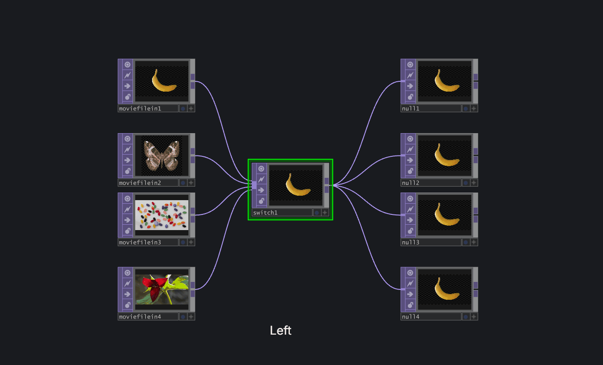

# TD Node Wire

[English](README.md) | [繁體中文](README.zh-TW.md) | **日本語**

TouchDesigner のオペレーター同士を、右ドラッグでつないだり切り離したりできるツールです。
Blender の Node Wrangler にある Lazy Connect と同じ感覚で使えます。



| 操作 | 動作 |
| --- | --- |
| **Alt + 右ドラッグ**（オペレーターから別のオペレーターへ） | 2 つをつなぐ |
| **Ctrl + 右ドラッグ**（オペレーターから外に向かって） | ドラッグした方向にある接続を 1 本切る |

- ドラッグ中はカーソルの横に、実行される操作が表示されます（`→ level1`、`✂ in 0 ← noise1`）
- 接続：最初の出力を、同じファミリーで空いている最初の入力につなぎます。入力がすべて埋まっている場合は、最初の入力を差し替えます
- 切断：ドラッグを始めたオペレーターの接続のうち、ドラッグした方向に応じて 1 本だけ切断します
  - **左上**：入力側のいちばん上
  - **左下**：入力側のいちばん下
  - **右上**：出力側のいちばん上
  - **右下**：出力側のいちばん下
  - 水平方向から ±20° 以内にドラッグした場合は、左方向なら**左上**、右方向なら**右上**として扱います
  - 出力側の上下は、接続先のオペレーターの位置で決まります
  - ドラッグが 10 px に満たない場合はキャンセルされます
- パレットのコンポーネント（pixelate、audioAnalysis など）にも対応しています。コンポーネントは、内部の in / out オペレーターのファミリーに基づいて処理されます
- どの操作も、Ctrl+Z を 1 回押せば元に戻せます
- タイムラインを一時停止していても動作します
- Alt / Ctrl を押していない右クリックや、何もない場所での右クリックは、これまでどおり TouchDesigner 側で処理されます

## インストール

[`node_wire.tox`](node_wire.tox) をプロジェクトのルート（`/`）にドラッグ&ドロップしてください。
コンポーネントはプロジェクトファイルの中に保存されるため、使いたいプロジェクトごとに一度ずつ追加する必要があります。
毎回追加するのが手間であれば、スタートアップファイル（Preferences > General > Startup File）に入れておくのがおすすめです。

**動作確認環境：** Windows。TouchDesigner 2025.33230、表示スケール 100% で動作を確認しています。

## 既知の制限

- Windows 専用です。右クリックを TouchDesigner より先に受け取るために、低レベルマウスフック（`WH_MOUSE_LL`）を使っています
- メインウィンドウ内のネットワークエディタでのみ動作します。別ウィンドウとして開いたネットワークエディタには対応していません
- 接続には、最初に見つかった出力が使われます（出力が 2 つあるコンポーネントの場合は `out1`）
- コンポーネントの上下方向の接続（COMP 同士の縦の接続）は、つなぐことも切ることもできません
- 表示スケールが 100% 以外の場合、カーソル横のラベルの位置がずれることがあります

## ソースコード

処理はすべて [`node_wire.py`](node_wire.py) にまとまっています。これはコンポーネント内の Text DAT `node_wire` の中身と同じものです。
編集したファイルを起動中のプロジェクトに読み込むには、Textport（Alt+T）で次を実行します。

```python
op('/node_wire/node_wire').text = open(r'<path>/node_wire.py', encoding='utf-8').read(); mod(op('/node_wire/node_wire')).install()
```

そのあと、コンポーネントを右クリックして *Save Component .tox* を選ぶと保存できます。

## ライセンス

[MIT](LICENSE)
