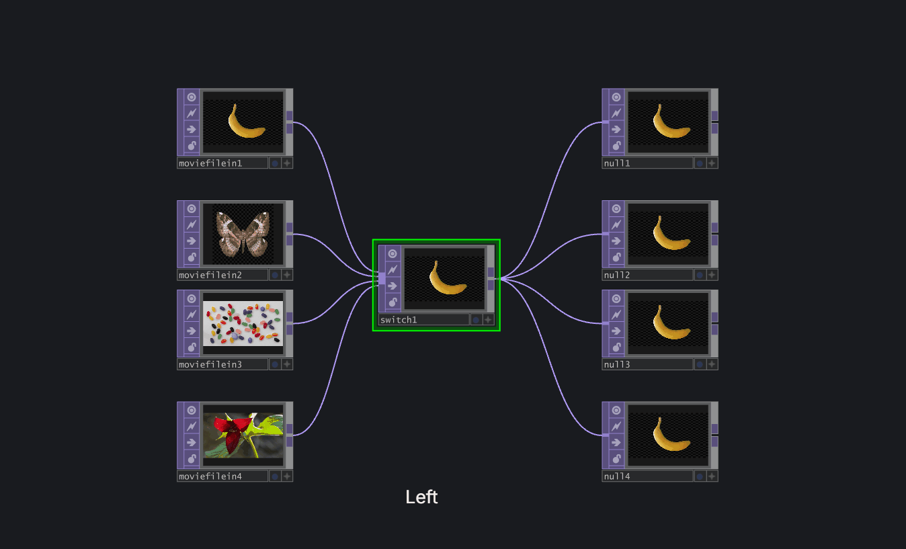

# TD Node Wire

[English](README.md) | **繁體中文**

在 TouchDesigner 裡用右鍵拖曳來接線、切線，類似 Blender Node Wrangler 的 Lazy Connect。



| 手勢 | 動作 |
| --- | --- |
| **Alt + 右鍵拖曳**，從一個節點拖到另一個節點 | 接線 |
| **Ctrl + 右鍵拖曳**，從節點往外拖 | 依方向切掉其中一條線 |

- 拖曳時，游標旁會顯示將要做的事（`→ level1`、`✂ in 0 ← noise1`）
- 接線：第一個輸出接到第一個空著、類型相同的輸入；全部接滿時，取代第一個
- 切線：依拖曳的方向，切掉起點節點上的其中一條線
  - **左上**：切輸入側最上面一條
  - **左下**：切輸入側最下面一條
  - **右上**：切輸出側最上面一條
  - **右下**：切輸出側最下面一條
  - 接近水平（與水平線夾角 20° 以內）時，往左算**左上**、往右算**右上**
  - 輸出側的上下，以線所連到的目標節點位置判斷
  - 拖不到 10 px 會取消
- 支援 palette 元件（pixelate、audioAnalysis 等），以它裡面 in / out 節點的類型判斷
- 每個動作都是一次 Ctrl+Z
- 時間軸暫停時也能用
- 沒按 Alt / Ctrl 的右鍵、在空白處的右鍵，都照常交給 TouchDesigner

## 安裝

把 [`node_wire.tox`](node_wire.tox) 拖進專案的根層（`/`）。
元件是存在專案檔裡的，所以每個要用的專案都要放一次，
或是放進啟動檔（Preferences > General > Startup File）。

**需求：** Windows。在 TouchDesigner 2025.33230、100% 顯示縮放下測試過。

## 已知限制

- 只支援 Windows：它用低階滑鼠 hook（`WH_MOUSE_LL`）在 TouchDesigner 之前攔下右鍵
- 只在主視窗裡的 Network Editor 有效；浮動的面板不支援
- 接線一律使用第一個相容的輸出（例如有兩個輸出的元件，只會用 `out1`）
- 元件上下方向的連線（COMP 的上下連線）不會接也不會切
- 顯示縮放不是 100% 時，游標旁的標籤位置可能會偏掉

## 原始碼

所有的程式都在 [`node_wire.py`](node_wire.py)，也就是元件裡 `node_wire` 這個 Text DAT 的內容。
要把修改過的檔案讀進執行中的專案，在 Textport（Alt+T）執行：

```python
op('/node_wire/node_wire').text = open(r'<path>/node_wire.py', encoding='utf-8').read(); mod(op('/node_wire/node_wire')).install()
```

然後在元件上按右鍵，選 *Save Component .tox*。

## 授權

[MIT](LICENSE)
